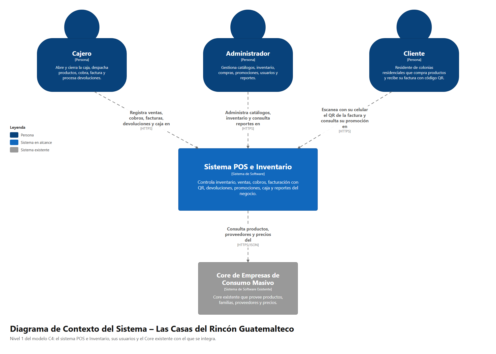
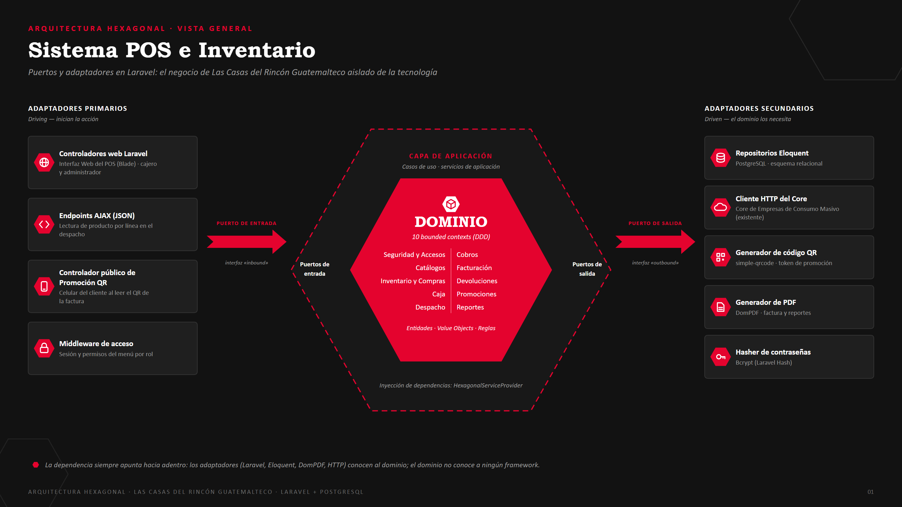

# Documentación de diseño

Diagramas del proyecto **Sistema POS e Inventario – Las Casas del Rincón Guatemalteco**.
Cada diagrama está en PNG (para documentos y presentaciones) y en SVG (editable).

**Documento de entrega completo:** [Proyecto_Final_Las_Casas_del_Rincon_Guatemalteco.pdf](Proyecto_Final_Las_Casas_del_Rincon_Guatemalteco.pdf) (portada, requerimientos, modelo C4, casos de uso, DDD, arquitectura hexagonal, MVC, base de datos, Kanban, pantallas, pruebas e instalación).

## Modelo C4

| Nivel | Diagrama |
|-------|----------|
| 1 · Contexto | [Nivel1_Contexto.png](c4/Nivel1_Contexto.png) |
| 2 · Contenedores | [Nivel2_Contenedores.png](c4/Nivel2_Contenedores.png) |
| 3 · Componentes | [Nivel3_Componentes.png](c4/Nivel3_Componentes.png) |
| 4 · Código | [Nivel4_Codigo.png](c4/Nivel4_Codigo.png) |

## Casos de uso

| Diagrama | Contenido |
|----------|-----------|
| [CU-00 General](casos-de-uso/CU-00_General.png) | Visión global de actores y funciones |
| [CU-01 Acceso y catálogos](casos-de-uso/CU-01_Acceso_y_Catalogos.png) | Login, usuarios, clientes, proveedores, productos y precios |
| [CU-02 Punto de venta](casos-de-uso/CU-02_Punto_de_Venta.png) | Caja, despacho, cobro y facturación |
| [CU-03 Devoluciones e inventario](casos-de-uso/CU-03_Devoluciones_e_Inventario.png) | Devoluciones, compras, existencias y kardex |
| [CU-04 Promociones y QR](casos-de-uso/CU-04_Promociones_y_QR.png) | Tipos de promoción, lectura y canje del QR |
| [CU-05 Reportes](casos-de-uso/CU-05_Reportes.png) | Corte de caja, devoluciones, clientes y compras |

## Arquitectura hexagonal

- [Diagramas_arquitectura_hexagonal.pdf](arquitectura-hexagonal/Diagramas_arquitectura_hexagonal.pdf): documento con portada, vista general y los 10 módulos.
- [HEX-00 Vista general](arquitectura-hexagonal/HEX-00_Vista_General.png), un diagrama por módulo (HEX-01 a HEX-10),
  [HEX-11 Flujo de una venta](arquitectura-hexagonal/HEX-11_Flujo_de_Venta.png) y
  [HEX-12 Estructura en Laravel](arquitectura-hexagonal/HEX-12_Estructura_Laravel.png).

## Kanban

El tablero del proyecto está en GitHub Projects: <https://github.com/users/AndrewUMG/projects/1>

## Regenerar los diagramas

Los scripts de [`scripts/`](scripts) generan los SVG con Python (`c4gen.py`, `ucgen.py <carpeta>`, `hexgen.py <carpeta>`).
Los PNG se obtienen abriendo cada SVG en un navegador o con Microsoft Edge en modo headless (`--screenshot`).
